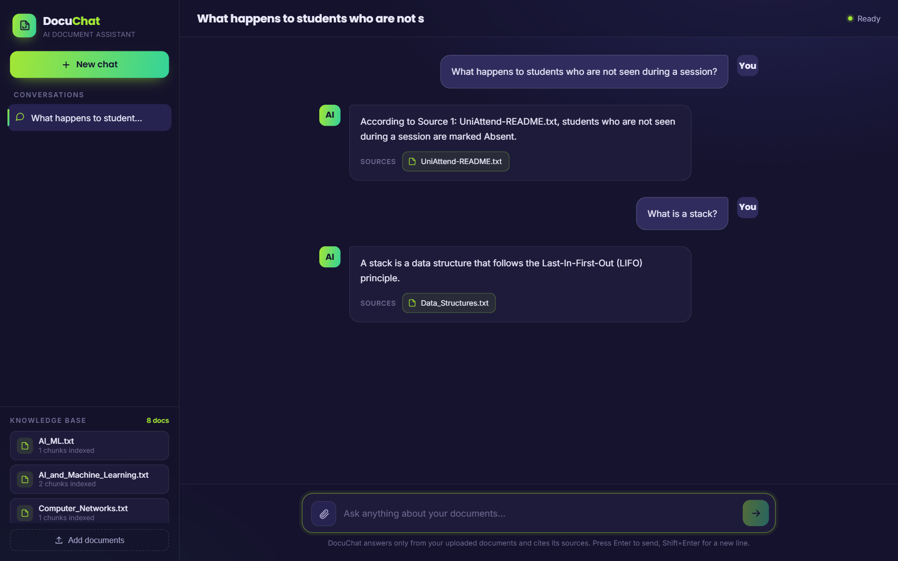
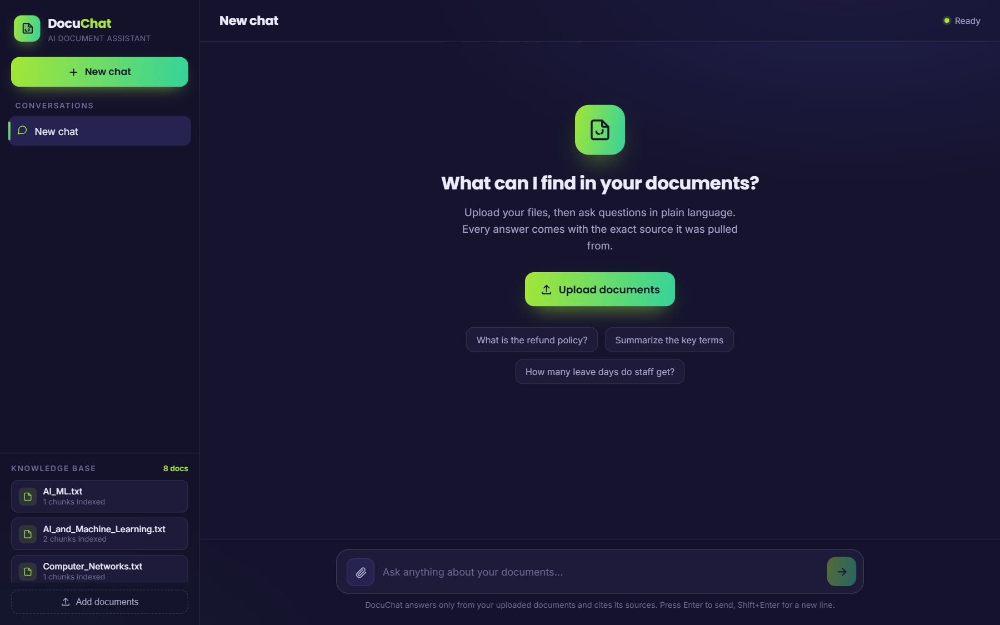

# DocuChat: private RAG over your own documents

Ask questions about your PDFs, Word files and text files in plain language and get
answers **with the source they came from**. Everything runs on your own machine:
embeddings, vector search and the language model. No API key, and no data leaves the PC.


<sub>Real answers from a local run, written by llama3.2:3b through Ollama (`DOCUCHAT_LLM=ollama`).</sub>

## Features

- **Upload in the browser**: drag in PDF, DOCX or TXT files; they're indexed into the live
  vector store immediately, with no restart. Re-uploading a file replaces its old version.
- **Grounded answers with sources**: the "documents" persona answers only from what was
  retrieved, and says so when the documents don't cover the question.
- **Two front ends**: a FastAPI web app (`docuchat_ui.html`) and a Streamlit chat app
  (a computer-science tutor with saved chat history).
- **Runs offline** on a laptop CPU, and uses the GPU automatically when CUDA is available.
- **Swappable answer model**: TinyLlama out of the box, or any model you run in
  [Ollama](https://ollama.com) for noticeably more faithful answers.

## How it works

```
 upload / data/sample_docs
        │
        ▼
 extract text (pypdf, python-docx) ──► ~300-character chunks, cut on word boundaries
        │
        ▼
 embed with all-MiniLM-L6-v2 ──► FAISS index (IndexFlatL2, saved to embeddings/)
                                        │
 question ──► embed ──► 5 nearest chunks (distance threshold) ──► context
                                                                    │
                                                                    ▼
              TinyLlama-1.1B-Chat (default) or an Ollama model, temperature 0
                                                                    │
                                                                    ▼
                                                answer + source documents
```

- **Retrieval**: [sentence-transformers](https://www.sbert.net/) `all-MiniLM-L6-v2` embeddings
  in a [FAISS](https://github.com/facebookresearch/faiss) index. Matches beyond a distance
  threshold are dropped, so unrelated questions don't get padded with irrelevant context.
- **Generation**: by default `TinyLlama/TinyLlama-1.1B-Chat-v1.0` through Hugging Face
  Transformers, prompted with its chat template. Only whole chunks go into the context, up to
  1,800 characters. A 1.1B model sometimes misreads its context, so generation can also go to
  any Ollama model over its HTTP API (standard library only, no extra package).
- **Concurrency**: the index is guarded by a lock and generation runs one request at a time,
  so uploads and questions from several browser tabs can't corrupt the index.

## Setup

```bash
python -m venv .venv
.venv\Scripts\activate            # macOS/Linux: source .venv/bin/activate
pip install -r requirements.txt
```

The models (TinyLlama + all-MiniLM-L6-v2, about 2.3 GB) download into the project's
`models/` folder on the first run. Leave `models/` out when you zip or share the project.

## Run

Build the index from `data/sample_docs` (and anything uploaded before):

```bash
python src/ingest.py
```

**DocuChat web app** (upload your own documents, answers with sources):

```bash
uvicorn rag_api:app --port 8000
```

Then open http://localhost:8000.

**Streamlit chat** (CS tutor over the sample documents):

```bash
streamlit run src/app.py
```

**Better answers with Ollama** (optional): install [Ollama](https://ollama.com), pull a chat
model, and point DocuChat at it before starting either app. TinyLlama is then never loaded,
so startup is also much faster.

```bash
ollama pull llama3.2:3b
set DOCUCHAT_LLM=ollama                      # macOS/Linux: export DOCUCHAT_LLM=ollama
set DOCUCHAT_OLLAMA_MODEL=llama3.2:3b        # optional, this is the default
uvicorn rag_api:app --port 8000
```

## Screenshots

| Knowledge base | Answers with sources |
|---|---|
|  |  |

## Project structure

```
rag_api.py           FastAPI: /upload, /chat, /documents, and serves the web UI
docuchat_ui.html     single-file web front end
src/documents.py     text extraction + chunking (shared by ingest and upload)
src/ingest.py        builds the FAISS index from data/sample_docs and data/uploads
src/retrieve.py      embedding model, FAISS search, live add/replace of documents
src/generate.py      TinyLlama prompting, personas, small-talk handling
src/app.py           Streamlit chat app
data/sample_docs/    sample computer-science notes
```

## Limitations

- Scanned PDFs have no text layer, so they need OCR first (`src/documents.py` shows where
  a Tesseract fallback plugs in).
- TinyLlama is small enough for any laptop but can contradict its own context; use the
  Ollama option above when answer quality matters.
